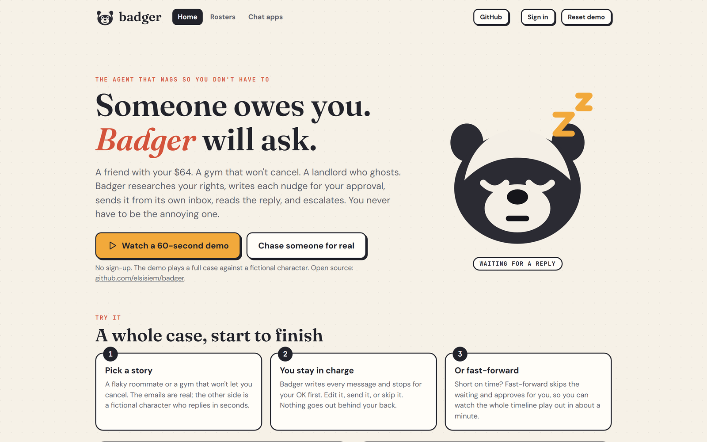

<p align="center"></p>
<h1 align="center">Badger</h1>
<p align="center">The agent that nags so you don't have to.</p>
<p align="center">
  <a href="https://badger-nags.fly.dev">Live demo</a> ·
  <a href="#how-it-works">How it works</a> ·
  <a href="#run-locally">Run locally</a>
</p>
<p align="center">
  <a href="https://github.com/elsisiem/badger/actions/workflows/ci.yml"></a>
  
  
</p>
<p align="center"></p>

## Why

Someone owes you something: a friend with your $64, a gym that won't cancel, a landlord who ghosts, a teammate who hasn't done their slides. Chasing them is awkward, so you don't, and you lose the money or the time. Badger does the awkward part. It researches your position, writes each message for your approval, sends it from its own inbox, reads the reply, and escalates.

## How it works

1. **Takes the case** by chat (assistant-ui and a Mastra agent) or one click. It finds a company's contact email if you don't have it.
2. **Researches** the company's policy and your rights with Exa, keeping only facts that come with an exact quote and a source URL.
3. **Plans** a short ladder of well-spaced nudges that get firmer, never rude.
4. **Drafts each message and waits for your approval.** You can edit it. Badger sends from its own AgentMail inbox and CCs you.
5. **Waits, durably.** The approval gate is a Mastra workflow that suspends and is snapshotted to Postgres, so it survives restarts and deploys.
6. **Reads replies.**
   - A promise pushes the clock out.
   - A refusal makes the next nudge firmer.
   - A question for you becomes a task.
   - A "use our web form" reply becomes a step where Badger fills in the form in a cloud browser (Kernel) and keeps a screenshot.
   - A "resolved" claim asks you to confirm before the case closes.
7. **Nags you, too.** Leave a draft unapproved and Badger reminds you.

Where it lives in the code:

- `src/workflows.ts` and `src/steps.ts`: the `prepare -> gate -> deliver` workflow and the next wake-up.
- `src/engine.ts`: case lifecycle, scheduler tick, approvals, reply handling.
- `src/brain.ts`: agents, prompts and the plan sanitizer.
- `src/mail.ts`: AgentMail client. Replies arrive by signed webhook, with a reconcile poll as backup so none is missed.

### Try the demo

Open the [live demo](https://badger-nags.fly.dev) (no sign-up) and press **Watch a 60-second demo**, or pick a story and approve each draft yourself.

1. **Pick a story**: a flaky roommate, or a gym that won't let you cancel. The emails are real AgentMail traffic. The other side is a fictional character who replies in seconds.
2. **You stay in charge.** Badger writes every message and stops for your OK. Edit, send, or skip.
3. **Or press Fast-forward.** It skips the waiting and approves for you, so the whole timeline plays out in about a minute.

The sandbox clock is 1 day = 20 s. Real cases run on a real clock, with days between nudges.

## Rosters

Teachers, coaches, landlords and club treasurers have twenty small debts, not one. A **group** is a roster: you log what each person owes (`Sam, lesson, $45`) and Badger runs the rest.

- One running balance per person. Log lessons from the web or by text.
- Badger opens a collection case automatically when something is overdue, after the grace period you choose, and sends gentle reminders on your schedule. More lessons logged? The open case updates instead of duplicating.
- Mark someone paid and it stops. Part payments are applied oldest-first.
- Standing approval is opt-in. By default every reminder waits for your tap. Turn on "send gentle reminders without asking me" per group for hands-off sending. Anything firmer, or any change of channel, still asks.
- Built for real relationships: use a parent's email for under-18s, you confirm your contacts expect reminders before a group can send anything, no recipient gets more than 2 emails a day, and a STOP reply ends it for good.

The home page has a **Try the teacher demo** button.

## Chat apps

Telegram, Slack and WhatsApp work the same way. Say `Sam had a lesson today, $45`, `Lee paid`, or `who owes me?` and Badger answers from your ledger. It also messages you when it needs a decision, and Telegram gets Approve and Skip buttons. Each app switches on when you add its credentials. Setup guides are in [`docs/CHANNELS.md`](docs/CHANNELS.md).

## Safety is enforced in code

An agent that emails strangers is also what a spam or harassment tool looks like, so every limit lives in `src/safety.ts` and `src/brain.ts`, not in a prompt.

- The first email, every escalation, every form, and any formal final notice need your approval. Autopilot can only relax routine follow-ups.
- Every message discloses that it comes from an AI assistant acting for you, with a case reference and a STOP instruction. A STOP reply ends the case and suppresses that address for every user.
- Caps: at most 3 emails to a person (3 or more days apart, never above "firm") and 8 to an organization per case, 12 per user per day (40 for roster groups), 2 per recipient per day, and a global kill switch (`SENDING_ENABLED`).
- Recipients: no system addresses, no other AgentMail inboxes, no sandbox characters outside the demo, and the suppression list is honored.
- Every outbound draft is checked for threats, claims of legal authority and secrets, with a repair pass and a plain template as the last resort.
- The plan is clamped in code. The model proposes steps. `sanitizePlan` enforces step counts, spacing, and that escalation goes only to an address Exa found.
- Forms are filled only on the counterparty's own domain, over https, and only plain text fields.
- Text from replies is classified and never obeyed.
- Badger is not legal advice and says so. It cites only what it can quote.

## Stack

| Component | Role |
|---|---|
| Mastra | Agents (intake, planner, drafter, reply classifier) and the durable `prepare -> gate -> deliver` workflow. The gate suspends until a human decides. Snapshots go to Postgres. |
| Anthropic Claude | Models behind the agents. `MODEL_SMART` plans and drafts, `MODEL_FAST` classifies replies. |
| AgentMail | Badger's own inbox: sends, threads replies, `extracted_text` for clean reply parsing, Svix-signed webhooks. |
| Exa | `/search` with `outputSchema` for contacts, policy quotes, deadlines and regulators. Every item must carry a quote and a URL. |
| Kernel | Cloud browser (live view and screenshot) to submit a company's web contact form. |
| Neon | Postgres for cases, events, messages and approvals, plus the Mastra workflow snapshots. |
| assistant-ui | The chat intake, streaming from a Mastra agent. The `open_case` tool call renders as a case card. |
| Hono | HTTP API, webhooks and static files. |
| Fly.io | Long-lived host. The scheduler and the durable workflow need a process that stays up. |

## Run locally

Prerequisites: Node 22.13 or later (the repo pins one through the `node` dev dependency, so npm scripts use it), a Postgres database with TLS (Neon works), and the API keys in [Configuration](#configuration).

```bash
npm ci
cp .env.example .env     # fill in the required variables
npm run dev              # http://localhost:8080, migrations run on boot
npm run check            # typecheck and 20 unit tests
npm run build            # rebuild the chat widget into public/chat/chat.js
```

`npm run db:migrate` runs the migrations on their own. `npm start` is what the Dockerfile runs. It does not read `.env`, so export the variables yourself or use `npm run dev`.

To play a user through a whole case against a running server:

```bash
BASE=http://localhost:8080 npx tsx scripts/e2e.ts roommate
```

The gym scenario's browser step needs a publicly reachable `PUBLIC_URL`, because Kernel's browser runs in the cloud. Test it against a deployed instance.

## Configuration

Source of truth: `src/env.ts`. The full list with comments is in [`.env.example`](.env.example).

| Variable | Required | Purpose |
|---|---|---|
| `DATABASE_URL` | Yes | Postgres connection string (TLS always on) |
| `SESSION_SECRET` | Yes | Signs session cookies |
| `ANTHROPIC_API_KEY` | Yes | Models for the agents |
| `AGENTMAIL_API_KEY` | Yes | Sending and reading email |
| `EXA_API_KEY` | No | Web research. Without it no research runs and cases have no cited sources |
| `KERNEL_API_KEY` | No | Cloud browser for web-form steps. Without it those steps report "Kernel is not configured" |
| `AGENTMAIL_INBOX` | No | Inbox Badger sends from. Default `askbadger@agentmail.to`, so set your own |
| `PUBLIC_URL` | No | Public base URL. An https value registers the AgentMail webhook at boot |
| `SENDING_ENABLED` | No | Set to `false` to draft and plan without sending anything |
| `DEMO_CLOCK_SCALE` | No | Sandbox clock speed. Default 4320 (1 day = 20 s) |
| `MODEL_SMART`, `MODEL_FAST` | No | Model ids for planning and drafting, and for classification |
| `TELEGRAM_*`, `SLACK_*`, `TWILIO_*` | No | Chat app credentials. See [`docs/CHANNELS.md`](docs/CHANNELS.md) |
| `SIM_*_INBOX` | No | Sandbox cast inboxes for the demos |

## Deploy

Badger runs on Fly.io as a single always-on machine. Change `app` and `PUBLIC_URL` in `fly.toml` first, then:

```bash
fly apps create
fly secrets import < .env
fly deploy --remote-only
fly scale count 1
```

The Dockerfile installs production dependencies and runs `tsx src/server.ts`.

## Project layout

```
src/brain.ts         agents, planning and drafting prompts, plan sanitizer
src/workflows.ts     Mastra workflow: prepare -> gate (suspend) -> deliver
src/steps.ts         prepare, approve and deliver logic, next wake-up
src/engine.ts        case lifecycle, scheduler tick, approvals, replies
src/safety.ts        every rule listed above
src/research.ts      Exa
src/kernel.ts        Kernel browser form-filling
src/mail.ts          AgentMail client
src/sim.ts           sandbox cast and fake gym website
src/intake.ts        chat agent and tools
src/api.ts           HTTP API, webhook, chat stream
src/groups.ts        rosters, ledger, auto-opened collection cases
src/channels.ts      Telegram, Slack and WhatsApp router, signature checks
src/rosterTools.ts   agent tools: log_charge, mark_paid, who_owes
public/              the app (vanilla JS) and the built assistant-ui widget
```

## Status

- The public demo runs on one Fly.io machine. Demo accounts can only nag the fictional sandbox characters. Real cases need a sign-in with your email.
- The 20 unit tests cover the safety rules, plan sanitizer, web-form gate, webhook signatures and roster parsing. The engine, database paths and agents are exercised by `scripts/e2e.ts` against live services, not in CI.
- WhatsApp works through the Twilio sandbox only. WhatsApp lets a business message you first only within 24 hours of your last message unless it uses approved templates, which are not registered.
- `ADMIN_SECRET` is read by `src/env.ts` but no route uses it yet.
- Not built: voice calls, shared team cases, recurring charges, payment links, a daily briefing, and a landlord repair-request playbook with local-law citations.

## Credits

Built for the Personal Agents hackathon, October 2026. Uses Mastra, AgentMail, Exa, Kernel, Neon, assistant-ui and Fly.io.

## License

MIT. See [LICENSE](LICENSE).
